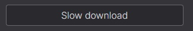
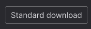

# Nexus Autoclicker

A small Windows app, written in Rust with a [Slint](https://slint.dev) GUI, that finds the Nexus "Slow download" button on screen and clicks it for you, so free Nexus users can download Wabbajack mod lists without babysitting the browser.

It is a rewrite of the Python script [wabbajack-autoclicker](https://github.com/nickolasdeluca/wabbajack-autoclicker). It does the same thing, but ships as a single `.exe` with no Python install required.

## Install

Open PowerShell and run:

```powershell
irm https://raw.githubusercontent.com/ndworks-dev/nexus-autoclicker/main/install.ps1 | iex
```

This installs the latest release for your user (no admin needed) into `%LOCALAPPDATA%\Programs\Nexus Autoclicker`, adds Start Menu and Desktop shortcuts, and opens the app. Run it again to update; your `config.toml` and images are kept. To uninstall, use **Settings > Apps > Installed apps**.

Prefer a portable copy? Download `nexus-autoclicker.exe` from the [latest release](https://github.com/ndworks-dev/nexus-autoclicker/releases/latest) and run it from any folder. `config.toml` and the `input_images` folder are created next to the executable.

## Disclaimer

I fully support Nexus and you SHOULD consider buying their premium membership, which has faster download speeds and also helps keep the lights on.

This tool is for people who are not avid Nexus users but every once in a while like to download a simple mod list to play with.

## How it works

Every iteration, the app takes a screenshot of every monitor and looks for each enabled image in `input_images/`:

| Default images | |
|---|---|
|  | `1_button.png` |
|  | `2_button.png` |

Images are searched in file-name order. When an image is found with at least the configured confidence, the mouse glides to its center and clicks, and the rest of that iteration is skipped (the page changes after a click, so the other buttons can't be there). Otherwise the best score is logged and the app tries the next image.

A match that is much darker than the image (below 70% of its contrast) is skipped. That happens when Nexus shows a dialog, such as the one for files over 500MB, and dims the page behind it: the "Slow download" button is still visible, but clicking it does nothing, so the app goes on to the dialog's "Standard download" button. Matching uses zero-mean normalized cross-correlation (the same metric as OpenCV's `TM_CCOEFF_NORMED`) with a coarse-to-fine search. A full-HD screen takes only a few milliseconds.

Hold **Esc** anywhere (or press **Stop**) to stop.

## Settings

All settings are editable in the window and saved to `config.toml` next to the executable:

| Setting | Default | Meaning |
|---|---|---|
| Max iterations | 99999 | How many loops to run before stopping |
| Click interval (ms) | 1000 | Pause after each image search/click |
| Loop interval (ms) | 3000 | Pause between iterations |
| Match threshold | 80% | Minimum similarity to count as found. Lower it if the button is missed, raise it if something else gets clicked |
| Minimize window while running | off | Keeps the app window out of the way of the browser |

Use **Add…** to add your own PNG screenshots of buttons, and untick an image to skip it.

## Tips

- Take button screenshots at the same browser zoom and display scaling you will use while running, because the matcher does not rescale images.
- The app is DPI-aware, so display scaling (125%, 150%, ...) and multiple monitors are handled.

## Building

Requires a recent stable Rust toolchain (edition 2024).

```sh
cargo build --release
# target/release/nexus-autoclicker.exe
```

On first run, if there is no `input_images` folder next to the executable, one is created with the default Nexus buttons.

Tests:

```sh
cargo test --release                     # unit tests
cargo test --release -- --ignored        # also matches the real buttons on a live screenshot
```

## Credits

The original Python script was a fork of [image_autoclicks](https://github.com/well-c/image_autoclicks), which was made to be generic. Check their work too.
